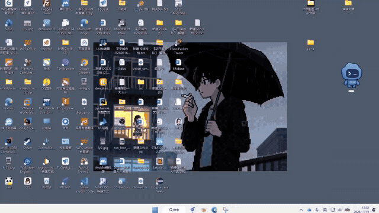

# Astral Codex · 星澜

[English](README.en.md) · [简体中文](README.md) · [Downloads](https://github.com/bohuis686-creator/AstralCodex/releases) · [Contributing](CONTRIBUTING.md)

[](demo/launch-demo.mp4)

Click the animation for the full recording with audio. The looping preview shows the desktop launch, character animation and handoff to Codex. Full media and details are in the [demo directory](demo/README.md).

An anime startup animation for the Windows Codex desktop client. Help us extend the same animation-to-window experience to more desktop applications. Contributions in code, animation, translation, testing and design are welcome.


The included 1080p video shows an original silver-haired character opening her eyes and summoning a holographic screen. The launcher starts Codex in parallel, then places a live DWM window thumbnail inside the screen and expands it into the actual application. Audio comes from the video, with a default volume of 30%.

## Try it

Requirements first: 64-bit Windows 10 or 11, and the Codex desktop client installed from the Microsoft Store (the launcher activates Codex through its Store identity, so a plain EXE install is not recognized yet). The .NET Framework 4.x WPF runtime and media components ship with Windows 10/11 by default; there is nothing else to install.

1. Download `AstralCodex-Windows.zip` from the [latest release](https://github.com/bohuis686-creator/AstralCodex/releases/latest) and extract the whole archive into a folder you will keep in place (for example `%USERPROFILE%\AstralCodex`). `Install-Desktop.cmd` retargets shortcuts into this folder, so moving or deleting it later breaks those shortcuts.
2. In that folder, run `Preview.cmd` to watch the animation without launching Codex. It plays once and closes itself shortly after the video ends; the `MaxWaitSeconds` value in `launcher.json` (default 60 seconds) is only a safety timeout. Press Esc to skip earlier.
3. Run `AstralCodex.exe` to play the animation and then hand off to Codex. If Codex is not installed, the launcher shows a message and closes. If Codex launches but its window never appears or becomes stable, the video holds at the transition and the launcher closes after `MaxWaitSeconds` (default 60 seconds) with a timeout message. Until the UI is localized, status and error messages render in Simplified Chinese.
4. Optional: run `Install-Desktop.cmd` from the same folder to retarget your existing desktop shortcuts for Codex to this launcher. It keeps each shortcut's icon, backs up the originals in the `.integration` backup folder, and changes nothing when no matching shortcut exists. `Restore-Desktop.cmd` puts the originals back. Keep the runtime folder and its `.integration` folder in place after installation.

## Build

Run `Build.cmd`, or run this command from the repository root.

```powershell
powershell.exe -NoProfile -ExecutionPolicy Bypass -File .\scripts\build.ps1
```

No SDK, project system or restore step is needed: `build.ps1` compiles the two `source/*.cs` files with the `csc.exe` that ships inside `%WINDIR%\Microsoft.NET\Framework64\v4.0.30319` on Windows 10/11, so a stock system is enough. One obsolete-API warning (`CS0618`, `FormattedText`) during compilation is expected. The build ends with a headless self-test that prints a JSON status line (`ok`, `configuration`, `assets`, `geometry`).

Output goes to `build/AstralCodex`. Builds preserve an existing runtime `launcher.json` and refresh bundled media. The script runs configuration, asset and transition geometry checks. CI performs the same build on Windows.

## Configure

Edit `launcher.json` in the runtime folder. `Volume` ranges from 0 to 1. `VideoHoldAt` defaults to 7.5 seconds, `VideoTransitionStart` to 8.25 and `VideoTransitionEnd` to 9.9. `MaxWaitSeconds` defaults to 60. A slow launch pauses the video before the transition until a stable, responsive client window is found.

`AppLaunch` is a `shell:AppsFolder\<AppID>` identifier. `ProcessNames` and `ProcessPathContains` select the client. Transition geometry in `source/Launcher.cs`, method `VideoDestination`, is calibrated for the supplied video. Different media needs new calibration.

The launcher resizes the selected Codex window to the monitor under the pointer. DWM failure uses a fade fallback. Window readiness is inferred from visibility and responsiveness. Esc leaves an already-issued application launch request running. The included video is 1920×1080, 24 fps, about 10.08 seconds, with AAC audio. Without `media/startup.mp4`, the legacy illustration mode uses `scene.png` and `startup.wav`. `--snapshot` exports only the legacy illustration scene.

## Build with us

The current preview supports Codex through MSIX activation. Win32 EXE launch, application profiles, configurable animation keyframes and broader display support are open contribution areas. See [Contributing](CONTRIBUTING.md), [extension design](docs/EXTENDING.md), and [open issues](https://github.com/bohuis686-creator/AstralCodex/issues).

Locally verified with build checks, video preview and handoff to an already-open Codex window. Cold starts, multiple monitors, mixed DPI and other client packages need wider community testing.

## Credits and license

Windows interop code is adapted from [Codex-WhiteDragon-AutoLaunch](https://github.com/suyuan132/Codex-WhiteDragon-AutoLaunch). Original notices are retained in LICENSE. Code is MIT licensed. AI-generated illustration, user-provided Doubao video and audio have their own provenance and service terms, described in [THIRD_PARTY_NOTICES.md](THIRD_PARTY_NOTICES.md). This is a community compatibility tool.
