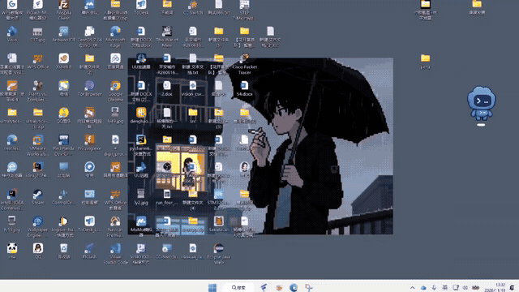

# 星澜 · Astral Codex

[简体中文](README.md) · [English](README.en.md) · [下载 Downloads](https://github.com/bohuis686-creator/AstralCodex/releases) · [参与贡献 Contribute](CONTRIBUTING.md)

[](demo/launch-demo.mp4)

点击上方动图观看完整有声录屏。动图节选桌面点击、人物动画到 Codex 窗口交接的过程，完整视频保存在独立的 [演示目录](demo/README.md)。

欢迎一起开发！星澜为 Windows Codex 制作二次元动态开场，也希望与社区一起将“播放动画、等待软件就绪、衔接真实窗口”的思路扩展到更多桌面软件。

当前预览版已实现 Codex MSIX 启动和窗口交接。普通 Win32 EXE、多软件配置与主题系统是欢迎贡献的后续方向。你可以贡献代码、动画主题、翻译、测试报告和设计建议。

[领取或提出任务](https://github.com/bohuis686-creator/AstralCodex/issues) · [贡献流程](CONTRIBUTING.md) · [跨软件扩展设计](docs/EXTENDING.md)

## 下载体验

在 Releases 中下载 `AstralCodex-Windows.zip` 并完整解压。运行 `Preview.cmd` 查看动画，运行 `AstralCodex.exe` 启动 Codex。需要桌面入口时，在运行包目录执行 `Install-Desktop.cmd`。请先把运行包放到固定位置。

源码 ZIP 需要先构建。下文介绍从源码运行及配置方法。


为 Windows Codex 桌面客户端制作的蓝白科幻二次元开场启动器。


银白发动漫少女在轨道指挥舱中睁眼、伸手并展开全息屏幕。启动器播放用户提供的 1080p 动态视频及自带音轨，在第 8.25 秒开始接入真实 Codex 窗口，第 9.9 秒完成交接。默认音量为 30%。

## 本地运行

需要 64 位 Windows 10/11、.NET Framework 4.x/WPF，以及可以正常启动的 Codex 桌面客户端。

1. 双击根目录的 `Build.cmd`，或在项目根目录运行以下命令。
2. 打开 `build/AstralCodex/Preview.cmd` 查看窗口化开场。
3. 打开 `build/AstralCodex/AstralCodex.exe` 启动 Codex 并播放开场。

```powershell
powershell.exe -NoProfile -ExecutionPolicy Bypass -File .\scripts\build.ps1
```

按 Esc 可跳过开场。预览自动关闭，并独立于 Codex 运行。可以为生成的 EXE 手动创建桌面快捷方式。

运行包内的 `Install-Desktop.cmd` 可将桌面已有的 Codex 快捷方式接入启动器，保留图标并备份原文件。`Restore-Desktop.cmd` 可恢复已备份的入口。安装后请保持运行包所在目录固定，恢复功能需要保留 `.integration` 文件夹。识别依据为快捷方式的真实启动目标。

## 配置

修改运行目录 `build/AstralCodex/launcher.json` 后，下次启动生效。重新构建会保留已有配置，素材会更新。

| 字段 | 用途 | 默认值 |
| --- | --- | --- |
| `Volume` | 开场音量，0 为静音，1 为最大值 | 0.3 |
| `VideoHoldAt` | 客户端未就绪时的视频等待点 | 7.5 |
| `VideoTransitionStart` | 视频中开始显现真实窗口的时间 | 8.25 |
| `VideoTransitionEnd` | 视频中完成窗口交接的时间 | 9.9 |
| `IntroSeconds` | 旧版插画模式的开场最短时间 | 5 |
| `TransitionSeconds` | 旧版插画模式的窗口展开时间 | 1.8 |
| `MaxWaitSeconds` | 最长等待窗口时间 | 60 |
| `AppLaunch` | Windows 应用启动标识 | Codex MSIX 标识 |
| `ProcessPathContains` | 客户端进程路径匹配项 | OpenAI.Codex_ |
| `ProcessNames` | 客户端进程名 | Codex、ChatGPT |

如果安装包标识不同，可在 PowerShell 中运行 `Get-StartApps | Where-Object Name -Match Codex`，将结果 AppID 加上 `shell:AppsFolder\` 前缀后填入 `AppLaunch`。进程路径及名称也需匹配实际安装版本。

正常启动时会把找到的 Codex 主窗口调整到鼠标所在显示器的全屏范围。窗口稳定性通过可见、可响应和持续存在的启发式检查判断。DWM 不可用时采用淡出交接。Esc 提前跳过时，已发出的 Codex 启动请求仍会继续。

## 素材与动画

`media/startup.mp4` 是用户提供的豆包生成动画，规格为 1920×1080、24 fps，约 10.08 秒，含 AAC 音轨。播放时保持画面比例。窗口位置关键帧在 `source/Launcher.cs` 的 `VideoDestination` 中按此视频标定，替换其他构图的视频后需要重新调整。

`media/scene.png` 和 `media/startup.wav` 保留供旧版插画模式使用。缺少 MP4 时使用旧版模式。视频存在但无法播放时会显示错误提示。

构建时执行配置、素材存在性、转场范围与多种屏幕比例的几何自测。EXE 的 `--snapshot` 参数仅导出旧版插画模式的静态图。动态效果请运行 `Preview.cmd` 查看。`last-run.json` 记录最近一次真实启动的视频打开、位置及窗口交接结果。

## 使用方式

使用者需要完整解压文件夹后运行 EXE。

## 许可

代码采用 MIT 许可，保留上游版权声明。窗口互操作代码来源和素材说明见 [THIRD_PARTY_NOTICES.md](THIRD_PARTY_NOTICES.md)。

## 一起扩展到其他软件

动画播放与窗口交接可以复用到其他桌面应用。当前 `AppLaunch` 校验和启动逻辑使用 Windows AppsFolder/MSIX 标识，普通 EXE 适配需要实现启动参数与工作目录、进程和主窗口匹配，以及快捷方式识别。详见扩展设计，欢迎提交 PR。

## 验证范围

已通过本地编译、自测、动态预览和 Codex 已打开状态的窗口交接。冷启动、多显示器、不同 DPI、远程桌面和不同安装版本仍欢迎测试。首版以预发布形式提供。
