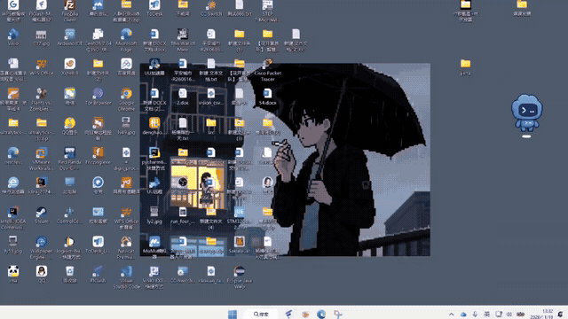

# 启动演示 · Launch demo

[中文首页](../README.md) · [English README](../README.en.md)

[观看完整有声视频 / Watch the full recording with audio](launch-demo.mp4)

录屏由项目维护者提供，展示从桌面入口启动星澜、播放人物动画，到交给真实 Codex 窗口的过程。完整视频约 16.6 秒，1280×720，保留原录屏的表情贴纸和画面。视频已转为 H.264/AAC MP4，方便浏览器播放。

首页 GIF 为原录屏约第 3 至 14.5 秒的无声循环预览，宽 640 像素、10 fps。完整有声版本位于 `launch-demo.mp4`。用于实际启动的主题视频位于 `../media/startup.mp4`。

The maintainer-provided recording demonstrates desktop launch, character animation and handoff to the real Codex window. The full recording is about 16.6 seconds at 1280×720. Existing emoji overlays are preserved. It is encoded as H.264/AAC MP4 for browser compatibility.

The homepage GIF is a silent loop of approximately seconds 3–14.5, at 640 pixels wide and 10 fps. Use the MP4 for the complete recording and audio. The actual launcher theme video is stored separately in `../media/startup.mp4`.
